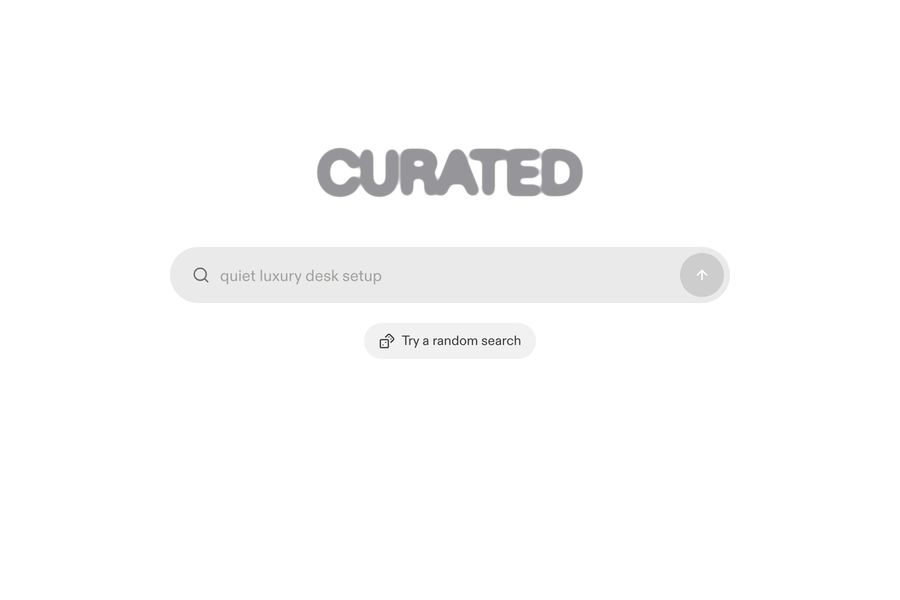

# Minimal marketplace search

Minimal marketplace search is a lightweight natural-language search for any product catalogue, built on [decision models](#how-a-search-works). Type what you're after the way you'd say it (a Bond villain's desk, a slim wallet that isn't leather, an espresso machine under $1000), and it finds the products that fit, reading every product's photo as well as its text. A search takes under two seconds and costs about half a cent, and the whole search runs in one Python process that keeps its index in memory.

**[Try the demo](https://curated-supply-search.vercel.app)** · **[Run it](#quick-start)** with uv, bun and two API keys



It comes with an example catalogue, the 1,301 products of [curated.supply](https://www.curated.supply/browse), used with its owner's permission:

| Search | First three products |
| --- | --- |
| `espresso machine under $1000` | Terra Kaffe Demi ($795), Breville Barista Express ($700), Wacaco Minipresso GR2 ($60) |
| `slim wallet that is not leather` | Ekster Aluminum Cardholder Wallet, Ridge Gunmetal Aluminum Wallet, The James Brand The Lowe |
| `a Bond villain's desk` | Omega Seamaster Diver 300M, Geistmaschine Bauwerk, Herman Miller Coyl Gaming Desk |
| `something Dieter Rams would own` | Vitsoe 606 Universal Shelving System, Braun BNE001 Calculator, Braun BC17 Wall Clock |

## Quick start

You need [uv](https://docs.astral.sh/uv/), [bun](https://bun.sh) and two API keys: one from [TypeSafe](https://typesafe.ai) for its decision model, which answers yes-or-no questions with a probability, and one from [OpenRouter](https://openrouter.ai) for the Gemini and GPT-6 Luna models and Perplexity's decision model, which judges the products when a call to TypeSafe's fails.

```bash
cp .env.example .env   # then fill in both keys
uv sync
uv run curated download
```

`curated download` fetches the example catalogue with its index built, 23 MB compressed, and checks it against `data-release.sha256` before unpacking. Then start the search server and the site, each in its own terminal:

```bash
uv run curated serve
```

```bash
cd web && bun install && bun run dev
```

Open http://localhost:3210. On a results page, press `d` to see how the search decided: each stage's timing, how the decision model read the search, and every product it judged.

## How a search works



Two calls start together. The decision model reads the search into the catalogue's categories and facets and says whether it states a price limit; when it does, Gemini Flash reads the amount. Gemini Flash-Lite writes the interpretation, at most 45 words on what the search refers to, so `a Bond villain's desk` can reach sleek dark objects its words never mention.

Eight rankings then search the products inside the price limit: BM25 keywords, text, photo and style vectors, and the decision model's facet tags on the buyer's words, and text, photo and style vectors on the interpretation. Reciprocal rank fusion merges them by rank, and tag expansion adds products whose tags match what the search asks for.

The last step is the gate. The decision model reads each product's card, a short text of its details, with its photo, and gives the probability that it answers the search. Products at 0.35 or more reach the page, highest first. Before that, while the interpretation is still on its way, the decision model reads the 24 best products found by the buyer's words alone, and those at 0.6 or more appear at once and stay at the top of the page. Scrolling to the end of the page judges the next 60 products.

Everything a search reads sits in `data/`: the products, what a model read from each one, the vectors as NumPy arrays and the small photos the decision model reads. Vector search is a matrix product in NumPy.

## Use your own catalogue



**1. Write `data/products.jsonl`**, one product per line:

```json
{"product_id": "walnut-desk-lamp", "url": "https://shop.example/walnut-desk-lamp", "name": "Walnut Desk Lamp", "brand": "Acme", "brand_slug": "acme", "category": "Lighting", "category_slug": "lighting", "lists": ["Small spaces"], "articles": [], "price": 120.0, "staff_pick": false, "rank": 0, "added": "2026-01-01", "about": "A small lamp with a walnut base and a brass arm.", "designed_in": "Denmark", "specs": [{"name": "Height", "value": "40 cm"}], "alternatives": [], "photo_url": "https://shop.example/img/walnut-desk-lamp.jpg"}
```

`lists` and `articles` name collections and articles that mention the product, and may be empty. Every field must be present, though the search ignores `brand_slug`, `staff_pick`, `rank`, `added` and `alternatives`. `price` is in US dollars, or `null`, and a product with no price passes every price limit.

**2. Save each photo** as `data/photos/<product_id>.webp`, the id encoded with `urllib.parse.quote(product_id, safe='')`. Keep that name for any image format: the build converts every photo to JPEG.

**3. Describe your catalogue** where the prompts describe curated.supply's, usually their first sentence: `INSTRUCTIONS` in `src/curated/indexing/reading.py`, `PROMPT` in `src/curated/indexing/taxonomy_writer.py` and `src/curated/search/interpretation.py`, `FILTER_PROMPT` in `src/curated/search/understanding.py`, and `GATE_FALSE` in `src/curated/search/gate.py`.

**4. Build the index**, about $1 per 1,000 products:

| Command | What it does | Cost for 1,301 products |
| --- | --- | --- |
| `uv run curated read --per-category 3` | Reads three products per category, to check the readings before paying for all | $0.02 |
| `uv run curated read` | GPT-6 Luna reads each product's text and photo: materials, colors, look, style and searches a buyer might type | $0.69 |
| `uv run curated taxonomy` | Writes the categories and facets to `taxonomy/taxonomy.yaml` | $0.01 |
| `uv run curated index` | Embeds text, style and photo, and has the decision model tag every product | $0.61 |

Run them in order. `read` and `index` save results as they arrive, so a rerun continues where it stopped. Then `uv run curated serve` serves your catalogue from `data/`.

**5. Rename the site**: the title in `web/app/layout.tsx`, and in `web/components/curated/`, the heading in `search-page.tsx`, the logo word in `wordmark.tsx`, the store link in `product-dialog.tsx` and the example searches in `examples.ts`.

`uv run curated package` writes your built catalogue to `dist/`, and `uv run curated download --source <path or URL>` unpacks it on another machine.

## How well it works

`benchmark/` holds 40 searches that never tuned the search, and two blind judges' grades of 644 search and product pairs, from 0 (wrong) to 3 (exactly right). A product counts as good at a mean grade of 2.

| Kind of search | Good in the first 10 | nDCG@10 | Good products found |
| --- | --- | --- | --- |
| All 40 | 78% | 0.88 | 90% |
| Brand or name | 100% | 0.96 | 99% |
| Stated limit | 94% | 0.91 | 86% |
| Attributes | 88% | 0.96 | 98% |
| Appearance | 80% | 0.94 | 89% |
| Across categories | 67% | 0.80 | 81% |
| Mood | 66% | 0.80 | 85% |
| Person, film or place | 40% | 0.71 | 92% |

Both judges were Claude reading product text, without photos, and each kind holds only 5 to 7 searches, so read the rows as rough. "Found" counts only graded products, so the true share is lower.

```bash
uv run curated benchmark run --name my-change    # about $0.20
uv run curated benchmark score --name my-change
```

## Known limits

- Searches that name a person, film or place are the weakest kind: only 78 of the 1,301 products' readings name a reference. `Steve Jobs's living room` has 1 good product in its first ten.
- Broad searches keep long tails: `things a design student would save up for` shows 94 of 100 products, with the weak ones at the end.
- The decision model's question is strict and loses some good products: `desk lamp under $150` shows 3.
- A product shown early stays at the top even when the gate later rates it lower.

## Models

These are the models the search uses as of November 2026, each with what was measured on the example catalogue.

| Job | Model | Measured |
| --- | --- | --- |
| Judging products, and reading the search | TypeSafe's decision model | Reads 6 products with their photos per call for about $0.00024; 78% good in the first ten on the benchmark |
| Judging products when that fails | Perplexity's decision model on OpenRouter, `perplexity/pplx-decider-v1.2` | On `slim wallet that is not leather` with TypeSafe's calls failing, it returned 12 products with the same top three, and the search cost $0.0020 against $0.0045; not yet benchmarked |
| Interpretation | Gemini 3.5 Flash-Lite | Within its 2.5 s limit on all 40 benchmark searches |
| Price limit | Gemini 3.8 Flash | Not compared with other models |
| Vectors | Gemini Embedding 2, 768 dimensions | Not compared with other models |
| Reading products | GPT-6 Luna | $0.0005 a product; not compared with other models |

Product photos go to the decision model at 280 pixels on their short side, which takes 70% of the tokens of 512 pixels and moved no answer by more than 0.06. Every model name is in `src/curated/settings.py`.

## Settings and spending

`src/curated/settings.py` also holds every count and threshold, including `daily_budget_usd`, $5 of paid calls per UTC day, and `searches_per_hour`, 60 per visitor. `data/ledger.jsonl` records every paid call, and `uv run curated spend` prints the totals. On Vercel, connect a Blob store so that every instance counts toward the same daily budget.

## Development

```bash
uv run pytest
```

The tests use stand-ins for both model APIs, so they need no keys and spend nothing. CI also runs `ruff`, `pyright`, and in `web/`, `tsc` and `eslint`.

| Path | Holds |
| --- | --- |
| `src/curated/search/` | The query path, run by `searcher.py` |
| `src/curated/indexing/` | Reading products, writing the taxonomy, and building the index |
| `src/curated/server.py` | The HTTP API |
| `src/curated/scrape.py`, `catalog.py` | Downloading and parsing the example catalogue |
| `src/curated/benchmark.py` | The benchmark commands |
| `web/` | The Next.js site |

## Licence

The code is under the [MIT licence](LICENSE). The licence does not cover the example catalogue's products, text and photos. `web/components/heat/heat-map.tsx` is adapted from Bencho's Heat map, under the MIT licence beside it.
